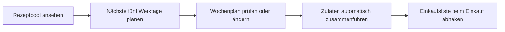

# Produktplan: Futter

## Ziel

Futter hilft Julian, aus einem festen Pool von Standardrezepten einen Essensplan für die Werktage zu erstellen. Jedes Rezept enthält strukturierte Zutaten. Aus den ausgewählten Gerichten wird automatisch eine zusammengeführte Einkaufsliste erzeugt.

Zielgerät ist zunächst das iPhone. Die erste Auslieferungsform soll eine responsive Web-App sein, die sich in Safari nutzen und optional zum Home-Bildschirm hinzufügen lässt (PWA); eine native App-Store-App ist nicht Teil des MVP.

## Kernablauf

## MVP-Anforderungen

- Mit Beispielgerichten starten; Rezepte mit Name, Beschreibung und Zutaten anzeigen.
- Ausschließlich Abendessen, immer zwei Portionen; kein Lunch-Mealprep und kein Portionsregler.
- Die nächsten fünf Werktage anzeigen (ab heute, sofern Werktag; Wochenende überspringen).
- Je Datum ein Gericht auswählen oder den Tag leer lassen. Keine Bindung an eine Kalenderwoche.
- Aus den gewählten Rezepten automatisch eine Einkaufsliste erstellen und bei jeder Planänderung aktualisieren.
- Gleiche Zutaten zusammenfassen, soweit Name und Maßeinheit kompatibel sind; sinnvolle Mengen addieren.
- Einkaufsliste nach Warengruppe sortieren und einzelne Artikel abhaken.
- Die App auf iPhone-Bildschirmbreite ohne horizontales Scrollen und mit gut bedienbaren Touch-Flächen darstellen.
- Den Plan nach Neuladen wiederherstellen.
- Einen gemeinsamen Haushalt für Julian und seine Partnerin unterstützen: Plan und Einkaufsstatus auf beiden Geräten teilen. Zugang über Web-Link und privates Haushaltspasswort.

## Grundlegende Datenbegriffe

- **Rezept:** stabile ID, Name, optionale Beschreibung und Zutatenliste.
- **Zutat:** normalisierter Name, Menge, Einheit und optionale Warengruppe.
- **Plan:** datumsbasierte Einträge; die Oberfläche zeigt die nächsten fünf Werktage. Jeder Eintrag verweist auf ein Rezept oder ist leer.
- **Haushalt:** gemeinsamer Datenbereich für zwei Personen; keine privaten Haushaltsdaten im öffentlichen Git-Repository.
- **Einkaufsliste:** aus dem gewählten Fünf-Tage-Zeitraum abgeleitet. Zeitraum und Abhakstatus müssen zusammen gespeichert werden; beim Weiterrücken des Zeitraums dürfen erledigte Artikel nicht unbemerkt für einen neuen Einkauf gelten.

Die Einkaufsliste soll abgeleitet sein und nicht als zweite, unabhängig gepflegte Zutatenkopie auseinanderlaufen. Manuell ergänzte Einkaufsartikel können später ergänzt werden, gehören aber nicht zum zwingenden ersten Kernablauf.

## Nicht-Ziele für den MVP

- KI-Vorschläge, Ernährungsanalyse oder Rezeptsuche im Internet.
- Händler-, Lieferdienst- oder Bezahlungsintegration.
- Native iOS-App und App-Store-Veröffentlichung.
- Öffentliche Registrierung oder mehrere Haushalte.

## Umsetzungsreihenfolge

1. **Produktentscheidungen festlegen:** Zugang für beide Geräte und die genaue Bedeutung des rollierenden Fünf-Tage-Zeitraums klären.
2. **Mobile Bedienung skizzieren:** Wochenübersicht, Rezeptauswahl und Einkaufsliste für schmale iPhone-Ansichten festlegen.
3. **Fachliche Basis bauen:** Rezept-/Zutatenmodell, Wochenplan und deterministische Zusammenführung der Zutaten.
4. **Kernoberfläche umsetzen:** Wochenplan bearbeiten und automatisch aktualisierte Einkaufsliste abhaken.
5. **iOS/PWA-Unterstützung ergänzen:** Manifest, Home-Bildschirm-Icons, Safe-Area-Layout und Standalone-Verhalten.
6. **Gemeinsame Speicherung und Zugang:** Plan und Einkaufsstatus zwischen beiden Geräten synchronisieren; gleichzeitige Änderungen nicht still überschreiben. Offline-Verhalten transparent halten.
7. **Abnahme auf iPhone Safari:** Auswahl, Mengenaggregation, persistente Liste, Touchbedienung und Home-Bildschirm-Start prüfen.

## Abnahmekriterien

- Es lassen sich Beispielgerichte für die nächsten fünf Werktage aus dem Rezeptpool auswählen.
- Alle Zutatenmengen gelten für ein Abendessen für zwei Personen.
- Beide Geräte sehen denselben Plan und Einkaufsstatus nach Synchronisierung.
- Samstag und Sonntag sind keine Plan-Slots.
- Wird ein Gericht geändert, spiegelt die Einkaufsliste die neuen Zutaten wider.
- Eine identische Zutat aus mehreren Rezepten wird sinnvoll zusammengeführt und ihre kompatiblen Mengen werden addiert.
- Abhaken einer Einkaufsposition bleibt nach Neuladen erhalten.
- Kernansichten und Eingaben sind auf einem iPhone bedienbar.

## Festgehaltene Entscheidungen

- Abendessen für zwei Personen, immer; kein Mittagessen am Folgetag einrechnen.
- Die nächsten fünf Tage planen, leere Tage erlaubt.
- Gemeinsame Nutzung mit der Partnerin; gemeinsamer Plan und Einkauf als empfohlener Ablauf.
- Beispielgerichte zum Start.
- Das GitHub-Repository bleibt öffentlich. Persönliche Laufzeitdaten werden nicht dort abgelegt.

## Bestätigte Details

- Die nächsten fünf Werktage ab heute, einschließlich heute; Wochenenden überspringen.
- Zugang per Web-Link mit privatem Zugang, nicht ausschließlich über Tailscale.
- Beide essen alles; Schwerpunkt vegetarisch und unkompliziert unter der Woche.
- Beispiele: acht Gerichte, sieben vegetarisch/vegan, maximal 30 Minuten, Mengen für zwei.

## Stand der ersten Version

Plan, Rezeptdetails, Einkaufsliste, lokale Vorschau und privater gemeinsamer Serverzugang sind implementiert. Die technische Umsetzung und bekannte Grenzen stehen in der README. HTTPS-Bereitstellung und echte iPhone-Safari-Abnahme stehen noch aus.

## Erster Bildschirmablauf

1. **Plan:** fünf kompakte Datumskarten, je ein Abendessen oder „Gericht wählen“, ein Hinweis „für 2“ und der Zugang zur Einkaufsliste. Ein Gericht lässt sich austauschen oder entfernen.
2. **Rezeptauswahl:** nach Antippen eines Tages öffnet sich der Rezeptpool mit Suche, kurzer Beschreibung und Zubereitungszeit. Rezeptdetails zeigen Zutaten für zwei und Zubereitung; „Für diesen Tag wählen“ setzt das Rezept ein.
3. **Einkauf:** oben der Zeitraum und die Zahl offener Artikel, darunter Zutaten nach Warengruppe mit Mengen und großen Abhakflächen. Änderungen am Plan aktualisieren die Liste automatisch.

Keine zusätzlichen Bestätigungsdialoge bei jeder normalen Auswahl. Datum, Zeitraum und Speicher-/Synchronisationsstatus sollen eindeutig sein.
