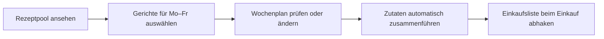

# Produktplan: Futter

## Ziel

Futter hilft Julian, aus einem festen Pool von Standardrezepten einen Essensplan für die Werktage zu erstellen. Jedes Rezept enthält strukturierte Zutaten. Aus den ausgewählten Gerichten wird automatisch eine zusammengeführte Einkaufsliste erzeugt.

Zielgerät ist zunächst das iPhone. Die erste Auslieferungsform soll eine responsive Web-App sein, die sich in Safari nutzen und optional zum Home-Bildschirm hinzufügen lässt (PWA); eine native App-Store-App ist nicht Teil des MVP.

## Kernablauf

## MVP-Anforderungen

- Standardrezepte mit Name, Beschreibung und Zutaten anzeigen.
- Für Montag, Dienstag, Mittwoch, Donnerstag und Freitag jeweils ein Gericht auswählen oder den Tag leer lassen.
- Aus den gewählten Rezepten automatisch eine Einkaufsliste erstellen und bei jeder Planänderung aktualisieren.
- Gleiche Zutaten zusammenfassen, soweit Name und Maßeinheit kompatibel sind; sinnvolle Mengen addieren.
- Einkaufsliste nach Warengruppe sortieren und einzelne Artikel abhaken.
- Die App auf iPhone-Bildschirmbreite ohne horizontales Scrollen und mit gut bedienbaren Touch-Flächen darstellen.
- Den Wochenplan nach Neuladen wiederherstellen.

## Grundlegende Datenbegriffe

- **Rezept:** stabile ID, Name, optionale Beschreibung und Zutatenliste.
- **Zutat:** normalisierter Name, Menge, Einheit und optionale Warengruppe.
- **Wochenplan:** Kalenderwoche mit fünf Slots (Mo–Fr); jeder Slot verweist auf ein Rezept oder ist leer.
- **Einkaufsliste:** aus Plan-Zutaten abgeleitete Liste; der Abhakstatus gehört zur betreffenden Kalenderwoche.

Die Einkaufsliste soll abgeleitet sein und nicht als zweite, unabhängig gepflegte Zutatenkopie auseinanderlaufen. Manuell ergänzte Einkaufsartikel können später ergänzt werden, gehören aber nicht zum zwingenden ersten Kernablauf.

## Nicht-Ziele für den MVP

- KI-Vorschläge, Ernährungsanalyse oder Rezeptsuche im Internet.
- Händler-, Lieferdienst- oder Bezahlungsintegration.
- Native iOS-App und App-Store-Veröffentlichung.
- Öffentliche Registrierung oder mehrere Haushalte.

## Umsetzungsreihenfolge

1. **Produktentscheidungen festlegen:** Wochenwechsel, Portionsgrößen und gewünschte Nutzung/Synchronisierung klären.
2. **Mobile Bedienung skizzieren:** Wochenübersicht, Rezeptauswahl und Einkaufsliste für schmale iPhone-Ansichten festlegen.
3. **Fachliche Basis bauen:** Rezept-/Zutatenmodell, Wochenplan und deterministische Zusammenführung der Zutaten.
4. **Kernoberfläche umsetzen:** Wochenplan bearbeiten und automatisch aktualisierte Einkaufsliste abhaken.
5. **iOS/PWA-Unterstützung ergänzen:** Manifest, Home-Bildschirm-Icons, Safe-Area-Layout und Standalone-Verhalten.
6. **Speicherung und Bereitstellung entscheiden:** lokale Offline-Nutzung zuerst; gemeinsame Synchronisierung nur, wenn sie benötigt wird.
7. **Abnahme auf iPhone Safari:** Auswahl, Mengenaggregation, persistente Liste, Touchbedienung und Home-Bildschirm-Start prüfen.

## Abnahmekriterien

- Es lassen sich Gerichte für alle fünf Werktage aus dem Rezeptpool auswählen.
- Samstag und Sonntag sind keine Plan-Slots.
- Wird ein Gericht geändert, spiegelt die Einkaufsliste die neuen Zutaten wider.
- Eine identische Zutat aus mehreren Rezepten wird sinnvoll zusammengeführt und ihre kompatiblen Mengen werden addiert.
- Abhaken einer Einkaufsposition bleibt nach Neuladen erhalten.
- Kernansichten und Eingaben sind auf einem iPhone bedienbar.

## Vor Implementierungsstart zu klären

1. Muss man kommende Wochen planen und vergangene Wochen wieder öffnen können, oder genügt zunächst die aktuelle Woche?
2. Für wie viele Portionen sollen Standardrezepte gerechnet werden? Soll diese Zahl änderbar sein?
3. Ist Futter nur für Julian/einen Haushalt gedacht, oder müssen mehrere Personen unabhängig voneinander synchronisieren?
4. Das GitHub-Repository ist derzeit öffentlich. Soll es öffentlich bleiben oder privat werden, bevor App-Code hineingepusht wird?

Bis diese Punkte entschieden sind, gelten folgende schlanke Defaults: eine Kalenderwoche mit fünf auswählbaren Werktagen, ein Rezept pro Slot, leere Slots erlaubt, keine externe Synchronisierung im ersten lokalen MVP.
